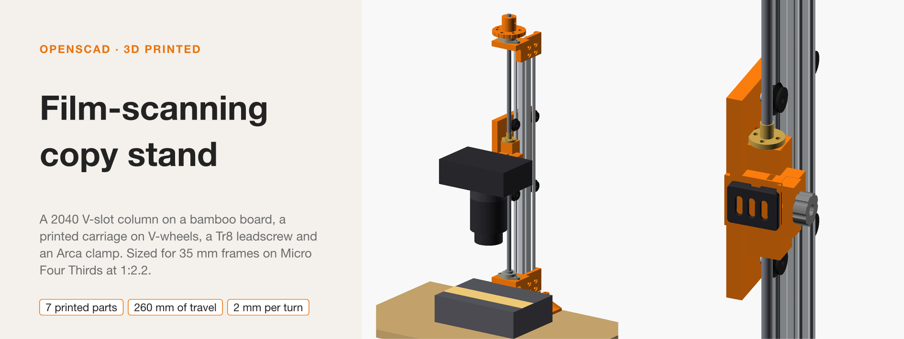

[](guide/assembly_guide.pdf)

# AI Film-scanning copy stand

A copy stand for scanning film (and other things) with a camera. It is based
on a 2040 V-slot column bolted on an IKEA APTITLIG cutting board. The entire
thing is pretty much designed by AI but in my tests it seems to work reasonably
well.

My setup is an OM System OM-3 with a Minolta AF (A-mount) 50mm f2.8 Macro,
which weighs approximately 950gr. The copy stand handles that without a
problem. My lightsource is a CS-Lite and the film-holder a tone-scanner,
both fit without any clearance problems. There is travel from 160 to 420mm
approximately and the lead-screw does not move at all under its own weight.

**Is it level?** In my tests with my camera, there seems to be approximately
a 0.8degree error at the heights I use it. It seems to be caused by the
rubber pads between the camera's bottom and the tripod's arcaswiss-style
plate. After putting some 1mm washers below my light source, the error is almost
completely gone, so I didn't bother searching for another solution.

I asked the AI agent to use OpenSCAD and the files are reasonably parametric.
For any changes I would ask some AI tool to go through the sources and do the
work.
 
Assembly instructions: [`guide/assembly_guide.pdf`](guide/assembly_guide.pdf).
Includes a bill of materials.

The rest of this file and the assembly guide are mostly AI-generated.

## Layout

- **Column:** the beam stands at the back edge of the board, 40 mm side
  front-to-back. Its foot (P6) bolts through the board. Four feet (P8)
  lift the board so the bolts' nuts underneath clear the table.
- **Carriage (P1):** rides the front and back V-grooves. The front wheels use
  fixed spacers and the back wheels use eccentric spacers. The carriage plate
  is on the beam's left-hand face as seen from the front.
- **Leadscrew:** sits in front of the beam and hangs from the top KFL08
  bearing. The handwheel (P7) holds the screw's brass nut, which rests on the
  bearing's inner ring. The bottom KFL08 only keeps the screw steady.
- **Anti-backlash nut:** sits on the carriage's nut tower, flange up, with a
  little float so it centres itself on the screw.
- **Brackets (P5, ×2):** two identical brackets bolt to the beam's right-hand
  face with T-nuts. The bottom one sits 60 mm up, so the 50 mm film holder
  slides in underneath. The top one rests on the beam's top end.
- **Clamp:** the fixed jaw is part of the carriage. The moving jaw (P3) is
  pushed in by the knob (P4) and a captive M5 nut. The plate drops in from
  above and rests on a stop pin.

## Files

| Path | What |
|---|---|
| `params.scad` | All dimensions. Tags: `[M]` measured, `[C]` catalogue, `[D]` design choice, `[?]` guess. |
| `vitamins.scad` | Simple models of the bought parts, for the assembly and clash checks. |
| `assembly.scad` | Full stand. Prints a layout report. `-D carriage_z=…` moves the carriage. |
| `parts/` | One file per printed part. `arca_clamp.scad` is shared by P0c and P1. |
| `stl/` | Exported parts, already oriented for printing. |
| `guide/` | Assembly guide: `build.py` renders the steps, `guide.typ` lays them out. |
| `renders/` | Images from the design reviews. |
| `samples/quickrelease.stl` | The TY-C10 plate by unwohlpol (CC BY-NC-SA 4.0, see `samples/README.md`), used to fit the clamp. |
| `bom.md` | The original brief and purchase list. |

## Bill of materials

### Printed (PLA, A1 mini)

| Part | Qty | Notes |
|---|---|---|
| P0a/P0a2/P0b/P0c test coupons | – | Wheel spacing, hole fits, KFL08 and nut fit, and the clamp. I was unsure about my hardware, these help you calibrate. |
| P1 carriage | 1 | Prints flat on the plate's outer face. No supports. |
| P3 moving jaw + P4 knob | 1 + 1 | `p3_p4_jaw_knob.stl` |
| P5 bearing bracket | 2 | Prints upside down, plate on the bed. |
| P6 foot | 1 | |
| P7 handwheel + crank sleeve | 1 + 1 | |
| P8 board feet | 4 | `p8_board_feet.stl` has all four. Board face down, no supports. |

Use 4 or more walls on P1, P5 and P6, with 30–40 % infill.

### Bought parts

| Part | Qty |
|---|---|
| V-slot 2040, 500 mm | 1 |
| Tr8×2 leadscrew, 500 mm, with brass flange nut | 1 |
| Anti-backlash nut, T8 2 mm lead | 1 |
| KFL08 pillow block | 2 |
| V-wheel kit: wheel, 2× 625 bearings, shim, spacer, nylock, M5×25 | 4 |
| Eccentric spacer, 6 mm, M5 | 2 |
| IKEA APTITLIG bamboo board, 450 × 280 × 15 | 1 |

### Fasteners

| Qty | Fastener | Used in |
|---|---|---|
| 5 | M5×30 socket head | wheels (4), clamp knob (1) |
| 4 | M5×25 socket head | KFL08s (the wheel kits' M5×25s) |
| 3 | M5×60 socket head | board (2), crank (1) |
| 8 | M5×10 low-profile | brackets |
| 5 | M5×12 low-profile | foot |
| 13 | M5 drop-in T-nut | foot (5), brackets (8) |
| 10 | M5 nut, H4 | KFL08s (4), board (2), clamp (1), crank (3) |
| 4 | M5 nylock + shim | wheels (from the kits) |
| ~10 + 2 | M5 washers, 2 large | KFL08s, under the board |
| 4 | M3×12–16 | anti-backlash nut, self-tapping into PLA |
| 4 | M3×8–10 | brass nut in the handwheel |
| 1 + 1 | M3×10 + M3 nut | handwheel lock screw |
| 4 | 3.5×16 countersunk wood screw | feet (or glue them on) |

## Rebuilding

Export the STLs with OpenSCAD 2026.10 or newer:

```sh
openscad --render -o stl/p1_carriage.stl         parts/p1_carriage.scad
openscad --render -o stl/p3_p4_jaw_knob.stl      parts/p3_p4_jaw_knob.scad
openscad --render -o stl/p5_bearing_bracket.stl  parts/p5_bearing_bracket.scad
openscad --render -o stl/p6_foot.stl             parts/p6_foot.scad
openscad --render -o stl/p8_board_feet.stl       parts/p8_board_feet.scad
openscad --render -o stl/p7_handwheel.stl        parts/p7_handwheel.scad
openscad --render -D 'part="crank_sleeve"' -o stl/p7_crank_sleeve.stl parts/p7_handwheel.scad
openscad --render -o stl/p0c_clamp_coupon.stl    parts/p0c_clamp_coupon.scad
openscad --render -D 'part="wheel"'   -o stl/p0a_wheel_coupon.stl       parts/p0_coupons.scad
openscad --render -D 'part="slot"'    -o stl/p0a2_wheel_slot_coupon.stl parts/p0_coupons.scad
openscad --render -D 'part="bearing"' -o stl/p0b_bearing_coupon.stl     parts/p0_coupons.scad
```

Rebuild the assembly guide (needs Typst):

```sh
python3 guide/build.py
typst compile --root . guide/guide.typ guide/assembly_guide.pdf
typst compile --root . --ppi 150 guide/banner.typ renders/banner.png   # README banner
```
## License

[CC0 1.0](LICENSE): public domain, with no conditions. Print it, remix it,
sell it; no credit needed. The design was mostly generated with an AI
assistant, so it may not be copyrightable anyway. CC0 waives whatever rights
there are, so nobody has to worry about it.

Not included: `samples/quickrelease.stl` is
["Tripod quick release plate"](https://www.printables.com/model/204259-tripod-quick-release-plate)
by **unwohlpol**, under
[CC BY-NC-SA 4.0](https://creativecommons.org/licenses/by-nc-sa/4.0/). It's
included unmodified as a fitting reference, and isn't needed to build the
stand; see
[`samples/README.md`](samples/README.md). Product names belong to their owners.
